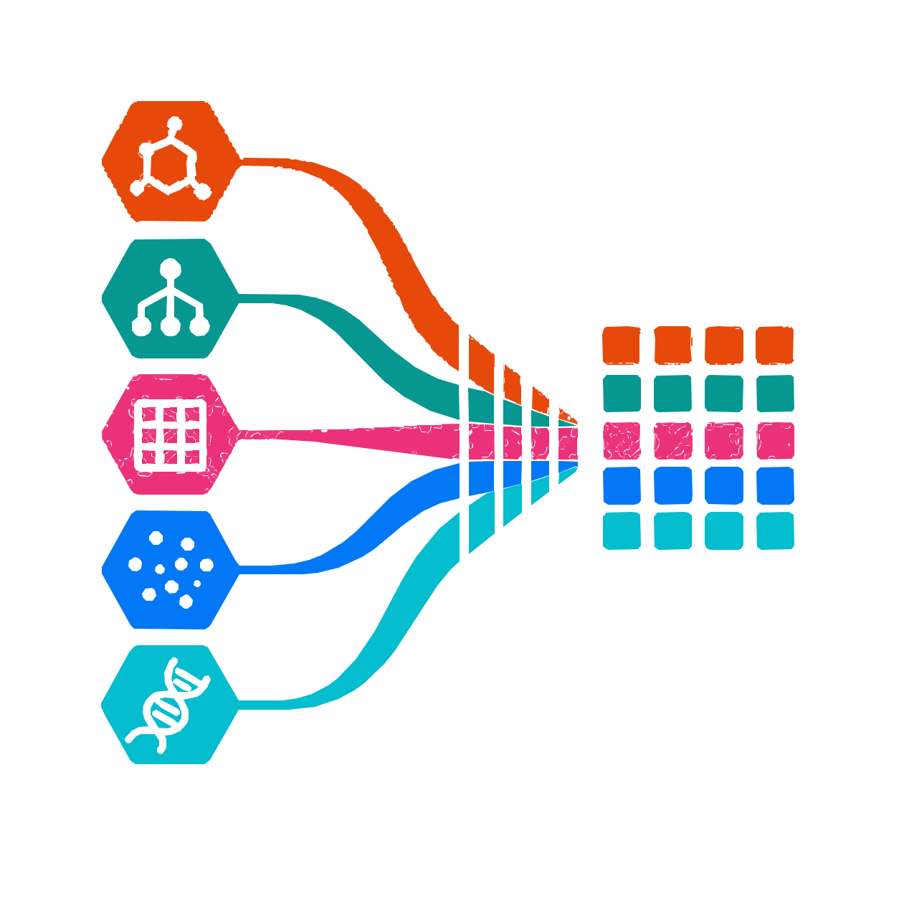

# 🏔️ aspect




**aspect** is a Python library and command-line tool for reproducible featurisation of tabular machine-learning datasets.

It lets you define independent transformation pipelines for different input columns, including molecular structures, taxonomy, categorical variables, and numerical measurements. Pipelines can be serialised, applied to new datasets, checkpointed, and restored.

Aspect uses [Providence](https://github.com/scbirlab/providence) for dataset loading, source provenance, and checkpointing, and [Hugging Face Datasets](https://huggingface.co/docs/datasets/) for Arrow-backed data processing and caching.

The core idea:

```text
Input dataset
    │
    ├── SMILES ──────→ Molecular fingerprints
    ├── Species ─────→ Taxonomic fingerprints
    ├── Assay ───────→ Categorical encoding
    ├── MW ──────────→ Log transformation
    └── Description ─→ Language-model embeddings
    │
    ▼
Aspect DataPipeline
    │
    ├── Reusable feature specification
    ├── Reproducible dataset checkpoint
    └── Optional source materialisation
    │
    ▼
Providence DataResolver
    │
    ├── Hugging Face Dataset
    ├── Export: CSV / TSV / JSON / Parquet
    └── Model-specific collation / DataLoader
```

Feature representations are stored in Arrow-compatible columns. Model-specific collators can convert these stored values into tensors, molecular graphs, or other runtime representations without embedding model-specific logic in dataset preprocessing.

## Contents

- [Quick start](#quick-start)
- [Installation](#installation)
- [Command-line interface](#command-line-interface)
- [Python API](#python-api)
- [Feature specifications](#feature-specifications)
- [Available transforms](#available-transforms)
- [Saving and loading pipelines](#saving-and-loading-pipelines)
- [Supported input and output formats](#supported-input-and-output-formats)
- [Working with output columns](#working-with-output-columns)
- [Custom transforms](#custom-transforms)
- [Model integration](#model-integration)
- [Development](#development)
- [Issues and documentation](#issues-and-documentation)

---

## Quick start

### 1. Featurise a dataset

Create a small CSV:

```bash
cat > compounds.csv <<'CSV'
compound_id,assay,mwt,pIC50
cmpd-1,MIC,46.07,5.0
cmpd-2,MIC,60.10,6.2
cmpd-3,IC50,78.11,4.8
CSV
```

Generate numeric and categorical features:

```bash
aspect featurize compounds.csv \
    --features mwt:log@log_mwt assay:hash@assay_hash pIC50@target \
    --extras compound_id \
    --output features.parquet
```

The feature specification defines the transformations:

| Specification | Meaning |
|---|---|
| `mwt:log@log_mwt` | Apply natural logarithm to `mwt` |
| `assay:hash@assay_hash` | Hash the assay category into a fixed-length vector |
| `pIC50@target` | Copy `pIC50` into a feature named `target` |
| `--extras compound_id` | Explicitly retain the compound identifier |

By default, Aspect also retains original input columns.

### 2. Save a reproducible checkpoint

The same command can save a checkpoint alongside the exported table:

```bash
aspect featurize compounds.csv \
    --features mwt:log@log_mwt assay:hash@assay_hash \
    --checkpoint features.as \
    --output features.parquet
```

The checkpoint records the feature specification, data source, and information needed to reconstruct the transformed dataset.

### 3. Restore and export

Reconstruct the transformed dataset from its checkpoint:

```bash
aspect write features.as \
    --output restored.parquet
```

Export it in another format:

```bash
aspect write features.as \
    --output restored.csv.gz
```

### 4. Python API

```python
from aspect.data import DataPipeline

data = {
    "compound_id": ["cmpd-1", "cmpd-2", "cmpd-3"],
    "assay": ["MIC", "MIC", "IC50"],
    "mwt": [46.07, 60.10, 78.11],
}

pipe = DataPipeline(
    column_transforms={
        "log_mwt": ("mwt", "log"),
        "assay_hash": (
            "assay",
            {"name": "hash", "kwargs": {"ndim": 8}},
        ),
    },
    columns_to_keep=["compound_id"],
)

resolved = pipe(data, drop_unused_columns=True)

# Access the underlying Hugging Face Dataset
features = resolved.data

print(features.column_names)
print(features[:2])
```

The transformed dataset contains:

```text
['compound_id', 'log_mwt', 'assay_hash']
```

`log_mwt` contains a numeric feature with shape `(n, 1)`, while `assay_hash` contains an `(n, 8)` feature matrix.

Save and reload the pipeline:

```python
pipe.save("features.as")

restored = DataPipeline.load("features.as")
print(restored.data_out.data[:2])
```

---

## Installation

Aspect requires Python 3.11 or later.

### Basic installation

```bash
pip install aspect-data
```

### Optional dependencies

Install only the features you need:

| Extra | Functionality | Installation |
|---|---|---|
| `chem` | Molecular fingerprints and descriptors via Schemist | `pip install "aspect-data[chem]"` |
| `bio` | Taxonomic fingerprints via Vectome | `pip install "aspect-data[bio]"` |
| `torch` | PyTorch integration | `pip install "aspect-data[torch]"` |
| `chemprop` | Chemprop molecular features | `pip install "aspect-data[chemprop]"` |
| `chemeleon` | Frozen CheMeleon molecular embeddings | `pip install "aspect-data[chemeleon]"` |
| `deep` | Transformer-based SMILES/text embeddings (includes `chem`) | `pip install "aspect-data[deep]"` |
| `esm` | ESM2 protein embeddings | `pip install "aspect-data[esm]"` |

### Install from source

```bash
git clone https://github.com/scbirlab/aspect.git
cd aspect
pip install -e ".[dev]"
```

Aspect depends on [Providence](https://github.com/scbirlab/providence) (`>=0.0.2`), which provides the common dataset-resolution and checkpointing infrastructure.

---

## Command-line interface

Aspect provides three commands:

```bash
aspect serialize
aspect featurize
aspect write
```

View available arguments with:

```bash
aspect --help
aspect featurize --help
aspect serialize --help
aspect write --help
```

### `aspect serialize`

Create a reusable feature specification without processing a dataset:

```bash
aspect serialize \
    --features mwt:log@log_mwt assay:hash@assay_hash \
    --extras compound_id \
    --output feature-spec.as
```

The specification can then be applied to other datasets:

```bash
aspect featurize new-compounds.csv \
    --config feature-spec.as \
    --output new-features.parquet
```

### `aspect featurize`

Apply a feature specification or saved pipeline to a dataset.

```bash
aspect featurize compounds.csv \
    --features mwt:log@log_mwt assay:hash@assay_hash \
    --output features.parquet
```

A saved specification can be supplied with `--config`:

```bash
aspect featurize compounds.csv \
    --config feature-spec.as \
    --output features.parquet
```

#### Checkpoint without exporting

```bash
aspect featurize compounds.csv \
    --config feature-spec.as \
    --checkpoint features.as
```

#### Save source and transformed data

```bash
aspect featurize compounds.csv \
    --config feature-spec.as \
    --checkpoint features.as \
    --force-write-data
```

This requests materialisation of both source and transformed data inside the checkpoint, making it less dependent on the original dataset remaining available.

Without this option, Providence can retain immutable remote datasets by reference, avoiding unnecessary duplication. Local inputs are generally packaged by the current implementation.

#### Process a subset of rows

```bash
aspect featurize large-table.parquet \
    --start 1000 \
    --end 2000 \
    --features mwt:log@log_mwt \
    --checkpoint subset.as
```

`--start` is inclusive and `--end` is exclusive. The example selects rows 1000–1999.

#### Configure the cache

```bash
aspect featurize compounds.csv \
    --features assay:hash@assay_hash \
    --cache .cache \
    --output features.parquet
```

Cached features are keyed on the transform configuration and on the installed versions of the feature backends (`schemist`, `rdkit`, `descriptastorus`, `vectome`, `chemprop`, `transformers`, `torch`). Upgrading any of these recomputes features rather than reusing a stale cache.

### `aspect write`

Export data from a saved Aspect checkpoint:

```bash
aspect write features.as --output features.csv
aspect write features.as --output features.csv.gz
aspect write features.as --output features.parquet
aspect write features.as --output features.hf
```

The checkpoint is loaded through `DataPipeline.load()` and the output is delegated to Providence.

If the checkpoint contains only a feature specification and no source dataset, there is no transformed table to export.

---

## Python API

The main class is `DataPipeline`.

```python
from aspect.data import DataPipeline
```

A pipeline maps input columns to named output features.

```python
pipe = DataPipeline({
    "log_mwt": ("mwt", "log"),
    "assay_hash": (
        "assay",
        {"name": "hash", "kwargs": {"ndim": 16}},
    ),
})
```

### Input data

Pipelines can be applied to Python mappings, Pandas DataFrames, Hugging Face datasets, local files, or Providence resolvers.

```python
# Dictionary
resolved = pipe({
    "mwt": [46.07, 60.10],
    "assay": ["MIC", "IC50"],
})

# Pandas DataFrame
resolved = pipe(df)

# Local file
resolved = pipe("compounds.csv")

# Hugging Face Hub dataset
resolved = pipe(
    "hf://datasets/scbirlab/fang-2023-biogen-adme~scaffold-split:train"
)
```

### Providence integration

Aspect uses Providence's `DataResolver` to manage source datasets and transformed results.

```python
from providence import DataResolver
from aspect.data import DataPipeline

source = DataResolver("compounds.csv")

pipe = DataPipeline({
    "log_mwt": ("mwt", "log"),
})

result = pipe(source)

# Underlying datasets
input_ds = pipe.data_in.data
output_ds = result.data

# Source metadata
source_info = pipe.data_in.data_source

print(output_ds.column_names)
```

`DataPipeline.__call__()` returns a `DataResolver`, rather than a raw Hugging Face dataset.

The underlying dataset remains available through `.data`, and provenance is tracked through the resolver.

### Exporting results

```python
pipe.write_table("features.parquet")
pipe.write_table("features.csv.gz")
```

This delegates serialization to Providence.

### Selecting rows

For explicit row selection, create and slice the resolver before passing it to Aspect:

```python
source = DataResolver("compounds.csv")
source = source.select_rows(start=100, end=200)

result = pipe(source)
```

### Reusing transformations

The same feature specification can be applied to multiple datasets:

```python
pipe = DataPipeline({
    "log_mwt": ("mwt", "log"),
})

train = pipe("train.csv")
test = pipe("test.csv")
```

Each call returns the corresponding transformed resolver. The pipeline's `data_in` and `data_out` attributes refer to the most recent call.

---

## Feature specifications

Aspect supports both structured Python specifications and compact CLI strings.

### Python specifications

The basic format is:

```python
{
    "output_column": ("input_column", "transform_name")
}
```

Example:

```python
pipe = DataPipeline({
    "log_mwt": ("mwt", "log"),
})
```

### Parameterised transforms

Pass a dictionary containing the transform name and keyword arguments:

```python
pipe = DataPipeline({
    "assay_hash": (
        "assay",
        {
            "name": "hash",
            "kwargs": {
                "ndim": 32,
                "seed": 123,
            },
        },
    ),
})
```

### Chained transforms

Pass a sequence of transformations:

```python
pipe = DataPipeline({
    "scaled_log_mwt": (
        "mwt",
        [
            "log",
            {
                "name": "scale",
                "kwargs": {"factor": 0.1},
            },
        ],
    ),
})
```

The `scale` transform in this example is a custom transform that must be registered first.

Chains execute in the supplied order. Each transform must accept the representation produced by the preceding transform.

### CLI specifications

The CLI format is:

```text
input_column:transform@output_column
```

| Syntax | Behaviour |
|---|---|
| `column` | Retain an input column |
| `column@new_name` | Identity transformation with a new name |
| `column:transform` | Apply a transform and automatically name the output |
| `column:transform@new_name` | Apply a transform with an explicit output name |
| `column:t1:t2@new_name` | Chain transformations |
| `column:transform(arg=value)@name` | Pass simple transform arguments |

Example:

```bash
aspect featurize compounds.csv \
    --features \
        mwt:log@log_mwt \
        assay:hash(ndim=32)@assay_hash \
        pIC50@target \
    --output features.parquet
```

Simple integers, floats, and booleans are parsed automatically. For complex or nested parameters, use the Python API.

---

## Available transforms

### Base transforms

Available with the standard installation:

| Transform | Input | Output |
|---|---|---|
| `identity` | Any supported column | Identity representation |
| `log` | Numeric | Natural logarithm |
| `hash` | Categorical/string | Deterministic fixed-length vector |
| `one-hot` | Categorical | One-hot vector |

Example:

```python
pipe = DataPipeline({
    "log_mwt": ("mwt", "log"),
    "assay_hash": (
        "assay",
        {"name": "hash", "kwargs": {"ndim": 16}},
    ),
    "assay_onehot": (
        "assay",
        {
            "name": "one-hot",
            "kwargs": {"categories": ["MIC", "IC50"]},
        },
    ),
})
```

### Chemistry transforms

Install with:

```bash
pip install "aspect-data[chem]"
```

| Transform | Input | Output |
|---|---|---|
| `morgan-fingerprint` | SMILES | Molecular fingerprint |
| `descriptors-2d` | SMILES | 2D molecular descriptors |
| `descriptors-3d` | SMILES | 3D molecular descriptors |

`descriptors-3d` averages RDKit 3D descriptors over an ETKDG conformer ensemble and appends their standard deviations across conformers. By default it embeds `clip(1 + rotatable bonds, 3, 10)` conformers per molecule, prunes near-duplicates (heavy-atom RMSD < 0.5 Å), and skips force-field minimisation. Options (`n_conformers`, `max_conformers`, `prune_rms_thresh`, `minimize`, `with_std`, `n_threads`, `seed`) go in `kwargs` and are recorded in the transform config:

```python
pipe = DataPipeline({
    "desc3d": ("smiles", {"name": "descriptors-3d", "kwargs": {"n_conformers": 20}}),
})
```

Example:

```python
data = {
    "compound_id": ["ethanol", "ethylamine", "benzene"],
    "smiles": ["CCO", "CCN", "c1ccccc1"],
}

pipe = DataPipeline(
    {
        "morgan": ("smiles", "morgan-fingerprint"),
        "desc2d": ("smiles", "descriptors-2d"),
    },
    columns_to_keep=["compound_id"],
)

features = pipe(data, drop_unused_columns=True).data
```

### Taxonomic transforms

Install with:

```bash
pip install "aspect-data[bio]"
```

The `vectome-fingerprint` transform encodes species names or taxonomic identifiers as fixed-length taxonomic representations.

```python
data = {
    "species": [
        "Mycobacterium tuberculosis",
        "Escherichia coli",
        "Staphylococcus aureus",
    ],
}

pipe = DataPipeline({
    "species_fp": (
        "species",
        {
            "name": "vectome-fingerprint",
            "kwargs": {"ndim": 128},
        },
    ),
})

features = pipe(data).data
```

### Deep-learning transforms

Install with:

```bash
pip install "aspect-data[deep]"
```

The `hf-bart` transform supports transformer-derived text embeddings.

```python
data = {
    "description": [
        "cell wall inhibitor",
        "protein synthesis inhibitor",
        "DNA gyrase inhibitor",
    ],
}

pipe = DataPipeline({
    "text_embedding": (
        "description",
        {
            "name": "hf-bart",
            "kwargs": {
                "ref": "facebook/bart-base",
                "aggregator": ["mean", "max"],
                "clean_smiles": False,  # free text, not SMILES
            },
        },
    ),
})

features = pipe(data).data
```

Inputs are embedded in length-sorted chunks of `batch_size` strings (default 64), and aggregators ignore padding tokens, so memory is bounded and embeddings do not depend on batch composition. Model weights may be downloaded on first use.

By default inputs are treated as SMILES and cleaned before tokenizing: canonicalized, desalted, and set to their dominant protonation state at pH 6.7 (`clean_smiles=True`, `desalt=True`, `protonate=True`, `protonation_pH=6.7`). Inputs that fail to parse are embedded as `<unk>`, so **set `"clean_smiles": False` for free text**, as in the example above.

### Protein embeddings

Install with:

```bash
pip install "aspect-data[esm]"
```

The `esm2` transform embeds amino acid sequences with an [ESM2](https://doi.org/10.1126/science.ade2574) protein language model, mean-pooling the final layer over residue tokens.

```python
data = {"sequence": ["MKTAYIAKQRQISFVKSHFSRQ", "MSLLTEVETPIRNEWGCRC"]}

pipe = DataPipeline({
    "protein_embedding": (
        "sequence",
        {
            "name": "esm2",
            "kwargs": {
                "model": "facebook/esm2_t12_35M_UR50D",  # 480-d; default
                "revision": "6fbf070e65b0b7291e7bbcd451118c216cff79d8",
            },
        },
    ),
})

features = pipe(data).data
```

Pin `revision` to a Hugging Face commit for reproducible embeddings. Other options: `layer` (default `-1`), `pooling` (`"mean"` or `"cls"`), `batch_size`, `device`, and `long_sequences` (`"truncate"` to 1022 residues, the default, or `"chunk"` for length-weighted overlapping windows). Missing or invalid sequences give zero vectors.

### Chemprop transforms

Install with:

```bash
pip install "aspect-data[chemprop]"
```

The `chemprop-mol` transform prepares molecular datapoints for Chemprop-style graph models.

Molecular graphs generally require model-specific batching. Aspect separates dataset storage from runtime collation so graph representations can be reconstructed when needed.

### CheMeleon embeddings

Install with:

```bash
pip install "aspect-data[chemeleon]"
```

The `chemeleon` transform embeds SMILES with the frozen message-passing encoder of [CheMeleon](https://doi.org/10.48550/arXiv.2506.15792), a Chemprop D-MPNN pre-trained on Mordred descriptors, giving 2048-d mean-aggregated vectors.

```python
pipe = DataPipeline({"chemeleon": ("smiles", "chemeleon")})
features = pipe(data).data
```

Weights are downloaded once from [Zenodo](https://zenodo.org/records/15460715) to `~/.chemprop/chemeleon_mp.pt` (shared with `chemprop train --from-foundation CheMeleon`) and verified by SHA-256. By default SMILES are desalted to the parent fragment and set to their dominant protonation state at pH 6.7 (`desalt=True`, `protonate=True`, `protonation_pH=6.7`), so `CC(=O)O.[Na+]`, `CC(=O)O` and `CC(=O)[O-]` give the same vector; set `desalt` and `protonate` to `False` to match upstream `CheMeleonFingerprint` exactly. Other options: `batch_size` (default 256) and `device`. Missing or invalid SMILES give zero vectors.

---

## Saving and loading pipelines

Aspect supports reusable feature specifications and provenance-aware dataset checkpoints.

### Save a feature specification

Create a pipeline without applying it to any dataset:

```python
pipe = DataPipeline({
    "log_mwt": ("mwt", "log"),
    "assay_hash": (
        "assay",
        {"name": "hash", "kwargs": {"ndim": 16}},
    ),
})

pipe.save("feature-spec.as")
```

Restore and apply it later:

```python
from aspect.data import DataPipeline

pipe = DataPipeline.load("feature-spec.as")

result = pipe({
    "mwt": [46.07, 60.10],
    "assay": ["MIC", "IC50"],
})
```

### Checkpoint a transformed dataset

```python
pipe = DataPipeline({
    "log_mwt": ("mwt", "log"),
})

result = pipe("compounds.csv")
pipe.save("features.as")
```

The checkpoint records the pipeline configuration and a Providence checkpoint describing the input dataset.

Load it again:

```python
restored = DataPipeline.load("features.as")

features = restored.data_out.data
```

By default, when transformed data has not been explicitly saved, loading reconstructs it by applying the feature pipeline to the restored source dataset.

### Materialise transformed data

```python
pipe.save(
    "features.as",
    save_transformed=True,
)
```

This stores a transformed-data checkpoint alongside the source checkpoint.

### Package source data

```python
pipe.save(
    "features.as",
    save_source_data=True,
    save_transformed=True,
)
```

This requests packaging of the input data and transformed data.

For remote datasets with immutable revisions, Providence can instead retain source references, allowing checkpoints to be substantially smaller.

Local sources are normally materialised to preserve reproducibility.

### Load without applying transformations

```python
pipe = DataPipeline.load(
    "features.as",
    skip_call=True,
)
```

This restores the specification and available checkpoint artefacts without automatically running the transformation pipeline.

### Checkpoint layout

A checkpoint may contain:

```text
features.as/
├── config.json
├── data.pv/
└── transformed.pv/
```

`config.json` contains the pipeline specification and checkpoint metadata.

`data.pv` contains the Providence source checkpoint.

`transformed.pv` is included when transformed data is explicitly checkpointed.

The contents of Providence checkpoints depend on whether datasets are retained by reference or materialised.

### Compatibility

The legacy methods `save_checkpoint()` and `load_checkpoint()` remain available as compatibility aliases, but new code should use `save()` and `load()`.

---

## Supported input and output formats

### Input types

Aspect accepts the input types supported by Providence, including:

| Input | Example |
|---|---|
| Python mapping | `{"smiles": ["CCO", "CCN"]}` |
| Pandas DataFrame | `pipe(df)` |
| Hugging Face Dataset | `pipe(dataset)` |
| Hugging Face IterableDataset | `pipe(iterable_dataset)` |
| Local file | `pipe("data.csv")` |
| Hugging Face dataset reference | `pipe("hf://datasets/org/repo~config:split")` |
| Providence DataResolver | `pipe(resolved)` |

### Local files

Commonly supported formats include:

- CSV: `.csv`, `.csv.gz`
- Tab-separated: `.tsv`, `.tsv.gz`, `.txt`, `.txt.gz`
- JSON: `.json`
- Parquet: `.parquet`
- Arrow: `.arrow`
- XML: `.xml`
- Saved Hugging Face datasets: `.hf`

### Output formats

The CLI and `write_table()` use Providence to select an output format from the filename.

| Extension | Format |
|---|---|
| `.csv` | CSV |
| `.csv.gz` | Gzip-compressed CSV |
| `.tsv`, `.txt` | Tab-separated text |
| `.tsv.gz`, `.txt.gz` | Gzip-compressed tab-separated text |
| `.json` | JSON |
| `.parquet` | Parquet |
| `.hf` | Hugging Face dataset directory |
| Unrecognised | Hugging Face dataset directory with `.hf` appended |

### Hugging Face Hub references

Providence supports versioned dataset references:

```text
hf://datasets/<owner>/<repo>~<config>:<split>@<revision>
```

For example:

```text
hf://datasets/scbirlab/fang-2023-biogen-adme~scaffold-split:train
```

The revision, configuration, and split are optional where supported by the resolver.

Pinning a dataset to an immutable commit revision improves reproducibility.

---

## Working with output columns

By default, Aspect retains original columns and adds transformed features.

```python
out = pipe(data)
```

To retain only transformed features and explicitly selected metadata:

```python
pipe = DataPipeline(
    {
        "log_mwt": ("mwt", "log"),
        "assay_hash": ("assay", "hash"),
    },
    columns_to_keep=["compound_id"],
)

out = pipe(
    data,
    drop_unused_columns=True,
)
```

Extra columns can also be specified at call time:

```python
out = pipe(
    data,
    drop_unused_columns=True,
    keep_extra_columns=["compound_id", "target"],
)
```

Access the underlying output dataset using:

```python
dataset = out.data
print(dataset.features)
print(dataset.column_names)
```

---

## Custom transforms

Custom transforms can be registered through Aspect's transform registry.

A transform factory receives configuration arguments and returns a callable that operates on data batches.

```python
import numpy as np

from aspect.data import DataPipeline
from aspect.transform.registry import register_function


@register_function("square")
def Square():
    def _square(data, input_column):
        x = np.asarray(data[input_column], dtype=float)
        return x ** 2

    return _square


pipe = DataPipeline({
    "mwt_squared": ("mwt", "square"),
})

out = pipe({
    "mwt": [46.07, 60.10, 78.11],
}).data
```

### Parameterised transforms

```python
@register_function("scale")
def Scale(factor=1.0):
    def _scale(data, input_column):
        x = np.asarray(data[input_column], dtype=float)
        return x * factor

    return _scale


pipe = DataPipeline({
    "scaled_mwt": (
        "mwt",
        {"name": "scale", "kwargs": {"factor": 0.001}},
    ),
})
```

Custom transforms must be registered in the Python process before loading pipelines that reference them.

---

## Model integration

Aspect separates stored feature representations from model-specific runtime inputs.

The output dataset may contain numeric arrays, chemical fingerprints, taxonomic encodings, or other Arrow-compatible values.

For simple numerical models, extract the dataset:

```python
features = pipe(data).data
```

For PyTorch models, use the built-in DataLoader integration:

```python
loader = pipe.dataloader(
    batch_size=32,
    shuffle=True,
)

for batch in loader:
    # Batched, collated features
    pass
```

This requires the `torch` extra.

Rows are read with the pipeline's `output_format` (default `"numpy"`), so floating-point features arrive as float32 tensors. A dataset you pass in that already has a format set keeps it.

Transforms requiring specialised runtime representations can provide collators. These are applied when constructing model batches, allowing features such as molecular graphs to be stored independently from the framework-specific objects consumed by a model.

Custom collators can be provided through the `collators` argument:

```python
loader = pipe.dataloader(
    batch_size=32,
    collators={
        "custom_feature": custom_collator,
    },
)
```

### Mixed molecular and biological features

Aspect can combine multiple representations in one dataset:

```python
data = {
    "compound_id": ["cmpd-1", "cmpd-2", "cmpd-3"],
    "smiles": ["CCO", "CCN", "c1ccccc1"],
    "assay": ["solubility", "clearance", "microsome"],
    "species": [
        "Escherichia coli",
        "Mycobacterium tuberculosis",
        "Staphylococcus aureus",
    ],
    "mwt": [46.07, 45.08, 78.11],
    "label": [0.1, 0.4, 0.8],
}

pipe = DataPipeline(
    {
        "morgan": ("smiles", "morgan-fingerprint"),
        "desc2d": ("smiles", "descriptors-2d"),
        "assay_hash": (
            "assay",
            {"name": "hash", "kwargs": {"ndim": 32}},
        ),
        "species_fp": (
            "species",
            {"name": "vectome-fingerprint", "kwargs": {"ndim": 64}},
        ),
        "log_mwt": ("mwt", "log"),
        "y": ("label", "identity"),
    },
    columns_to_keep=["compound_id"],
)

features = pipe(
    data,
    drop_unused_columns=True,
).data
```

This requires the chemistry and taxonomy extras.

Downstream models can independently consume molecular fingerprints, descriptors, categorical features, and taxonomic encodings, or combine suitable dense features into a common representation.

---

## Development

Install the development dependencies:

```bash
pip install -e ".[dev]"
```

Run the test suite:

```bash
pytest
```

Run module doctests:

```bash
pytest aspect --doctest-modules
```

Run the CLI integration tests:

```bash
bash test/scripts/run-tests.sh
```

Aspect maintains separate GitHub Actions workflows for Python tests and CLI smoke tests.

## Related packages

Aspect is part of a small ecosystem for reproducible molecular machine-learning workflows:

- [Providence](https://github.com/scbirlab/providence) — Dataset loading, source provenance, and checkpointing.
- [Eluent](https://github.com/scbirlab/eluent) — Chemistry-aware grouping, splitting, and cross-validation.
- [Schemist](https://github.com/scbirlab/schemist) — Molecular featurisation and cheminformatics.
- [Vectome](https://github.com/scbirlab/vectome) — Taxonomic and biological representations.

The packages can be used independently or composed into reproducible workflows from source data to model-ready features and evaluation splits.

---

## Issues and documentation

Bug reports, feature requests, and contributions are welcome through the [GitHub issue tracker](https://github.com/scbirlab/aspect/issues).

Documentation: [aspect.readthedocs.org](https://aspect.readthedocs.org)

Source code: [github.com/scbirlab/aspect](https://github.com/scbirlab/aspect)

License: MIT.
